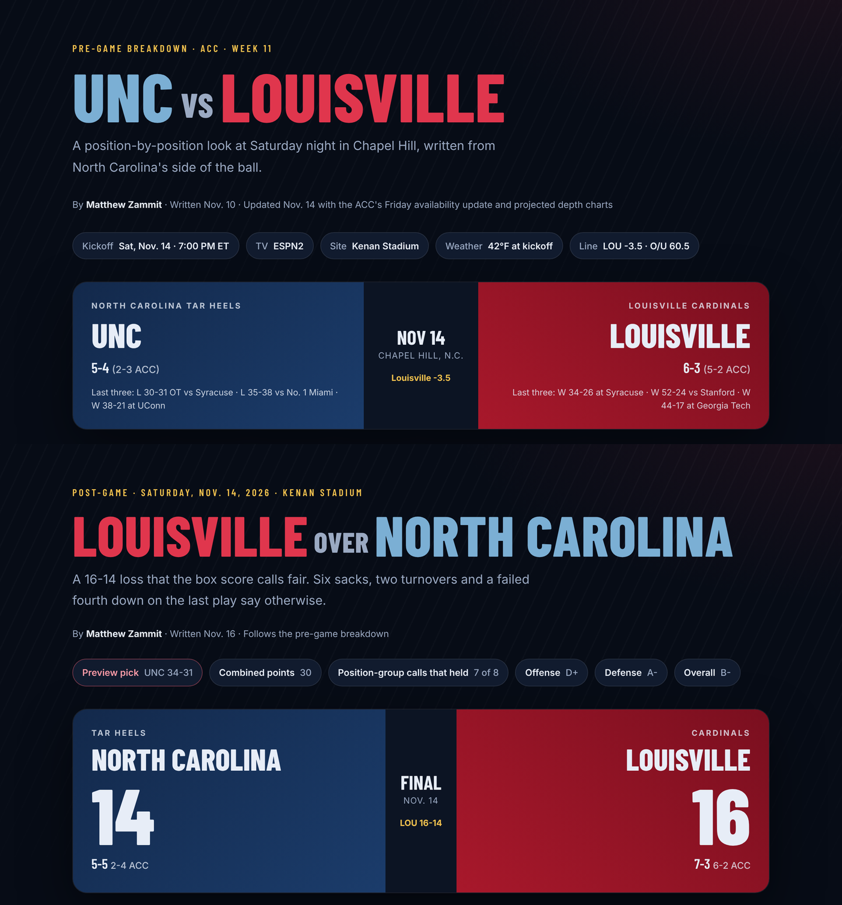

# unc-louisville-breakdown

A pre-game and post-game breakdown of North Carolina vs Louisville (Saturday, Nov. 14, 2026, Kenan Stadium), written from the Tar Heels' side. Louisville won 16-14.

## What's in here

- **`pregame.html`** is the pre-game breakdown: both rosters position by position, matchups, where UNC should attack, where it should worry, and a 34-31 UNC pick. Updated for the ACC's Friday availability report.
- **`index.html`** is the post-game breakdown: game flow, snap counts for every UNC player, position grades (offense D+, defense A-, overall B-), and a scorecard of how the pre-game calls held up (7 of 8).

## View it

Open either file in a browser. Each is a single self-contained page, so there is nothing to build or install. Fonts load from Google Fonts, so they look best online.

To host it, enable GitHub Pages on the main branch root. `index.html` will be the front page and the pre-game will be at `/pregame.html`.

Independent analysis, not affiliated with either program.
